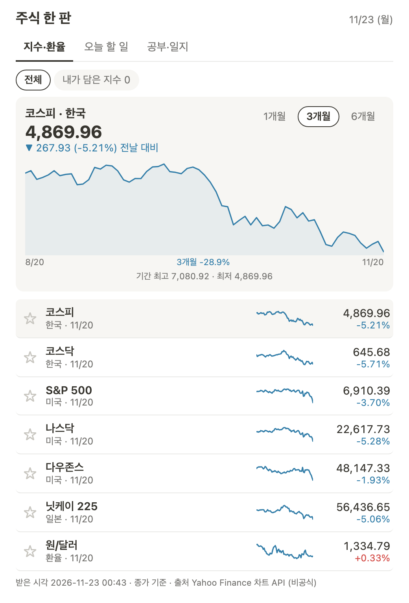

# 다운의 미니 위젯

슈크림마을 노션 바이브 코딩 동아리 「개발했슈」 2기 활동으로 만든 노션 임베드용 위젯입니다. 앞의 셋은 2주차 연습, `주식 한 판` 은 3주차에 만든 내 위젯입니다.
위젯마다 `index.html` 파일 하나로 돌아가고, 외부 라이브러리나 서버를 쓰지 않습니다.

| 폴더 | 위젯 | 하는 일 | 주소 |
|---|---|---|---|
| `jusik-hanpan/` | 주식 한 판 | 주요 지수와 원/달러 환율 그래프, 내가 담은 지수, 오늘 할 일, 공부·투자 일지를 한 위젯에 모았습니다 | https://hwwwaan.github.io/daun-widgets/jusik-hanpan/ |
| `random/` | 랜덤 뽑기 | 한 줄에 하나씩 적은 후보 중 하나를 무작위로 뽑습니다 | https://hwwwaan.github.io/daun-widgets/random/ |
| `timer/` | 카운트다운 타이머 | 1~99분을 넣고 시작하면 MM:SS 로 줄어들다가 00:00 에 「완료!」를 띄웁니다. 일시정지·다시 시작이 됩니다 | https://hwwwaan.github.io/daun-widgets/timer/ |
| `habit/` | 해빗 트래커 | 습관 하나를 이번 주 월~일 체크박스로 기록합니다 | https://hwwwaan.github.io/daun-widgets/habit/ |

## 노션에 붙이는 법

1. 위젯을 넣을 노션 페이지에서 `/embed` 를 입력하고 「임베드」를 고릅니다.
2. 위 표의 주소를 붙여 넣고 「링크 임베드」를 누릅니다.
3. 블록 오른쪽 아래 모서리를 끌어 크기를 맞춥니다. 「주식 한 판」은 폭 480px 에서 세로 760px 안팎이면 지수 탭이 스크롤 없이 다 보입니다.

## 주식 한 판 쓰는 법

**지수·환율 탭**
- 처음 열면 코스피·코스닥·S&P 500·나스닥·다우존스·닛케이 225·원/달러가 최근 종가, 전날 대비, 작은 그래프와 함께 보입니다.
- 줄을 누르면 위 큰 그래프가 그 지수로 바뀝니다. 1개월·3개월·6개월을 누르면 기간과 기간 등락률이 바뀌고, 그래프 아래에 기간 최고·최저가 나옵니다.
- 줄 왼쪽 ☆ 를 누르면 ★ 가 되고 「내가 담은 지수」에 모입니다. 「내가 담은 지수」를 누르면 담은 것만 보입니다.

**오늘 할 일 탭**
- 할 일을 적고 「추가」를 누르면 목록에 생기고, 체크하면 줄이 그어집니다. × 로 지웁니다.
- 날짜마다 따로 저장돼서 다음 날에는 새 목록이 열립니다. 노션에 열어 둔 채 자정이 지나도 오늘 날짜로 넘어갑니다.

**공부·일지 탭**
- 날짜와 종류(공부·투자 일지)를 고르고 글을 쓴 뒤 「저장」을 누르면 최근 것부터 쌓입니다.
- × 를 누르면 「지울까요?」로 바뀌고, 한 번 더 눌러야 지워집니다.

## 알아 둘 것

- **지수는 실시간이 아닙니다.** 장이 끝난 날의 종가를 받아 둔 것이고, 위젯 맨 아래에 받은 시각이 적혀 있습니다. 받은 지 사흘이 넘으면 빨간 글씨로 알려 줍니다.
- **기록은 이 브라우저에만 남습니다.** 담은 지수, 할 일, 일지는 노션 데이터베이스가 아니라 브라우저 localStorage 에 저장됩니다. 노션 앱과 크롬 노션, 다른 기기 사이에는 공유되지 않고, 브라우저 데이터를 지우면 사라집니다. 저장이 막힌 화면에서는 위젯 아래에 안내가 뜹니다.
- **매매 판단이나 종목 추천은 하지 않습니다.** 공부와 기록을 돕는 위젯입니다.

## 지수 자료 갱신

`python3 tools/fetch_indices.py` 가 Yahoo Finance 차트 API(비공식, 키 없음)에서 최근 6개월 일별 종가를 받아 `jusik-hanpan/data/indices.json` 에 저장합니다.
브라우저에서 바로 부르면 CORS 로 막혀서 이렇게 미리 받아 두고, 위젯은 같은 저장소의 파일만 읽습니다. 장이 열려 있는 날의 값은 빼고 끝난 날만 담습니다. 지금은 손으로 돌려서 갱신합니다.
